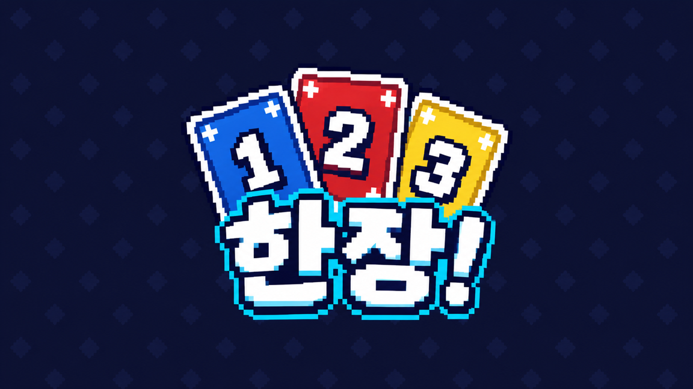

# 한장!

4명이 같이 하는 픽셀 원카드 게임입니다. Godot 4.7로 만들었고, 맥 앱과 휴대폰 브라우저가 같은 방에서 같이 할 수 있습니다.



## 특징

- **2~4명** 방, 표준 108장, 차례 20초. 방 주인이 판정을 하고 각자는 자기 패만 받습니다.
- 카드와 화면은 모두 픽셀 아트이고 효과음은 없습니다.
- **맥 앱**과 **모바일 웹**(가로 화면, 한 번 눌러 올리고 한 번 더 눌러 내기)이 같은 방에 들어옵니다.
- **릴레이 서버**가 있으면 같은 와이파이가 아니어도 방 링크나 방 코드로 들어옵니다. 공개 방은 목록에 뜨고 비공개 방은 코드로만 들어옵니다.
- 끊기면 같은 자리로 다시 들어올 수 있고(재접속 토큰), 방 주인이 나가면 30초 뒤 다음 사람이 이어받습니다.

## 필요한 것

- [Godot 4.7.2](https://godotengine.org/) (이 레포는 `engine/Godot.app` 에 둔 것을 씁니다. `engine/` 은 git에 올리지 않았습니다.)
- 웹 빌드를 내보내려면 Godot 4.7.2 웹 내보내기 템플릿(스레드 없는 `web_nothreads`)
- 릴레이 서버: Python 3 (표준 라이브러리만 사용), 터널을 열려면 `cloudflared`

## 실행

같은 컴퓨터에서 창 두 개로 해 보기 (맥):

```sh
./두창으로_테스트.command      # 방장 1 + 접속 1
./네창으로_테스트.command      # 방장 1 + 접속 3
./에디터_열기.command          # Godot 에디터
```

직접 실행:

```sh
godot --path game -- --host                      # 방 열기 (포트 7777)
godot --path game -- --join=192.168.0.5          # 방 들어가기
```

## 웹 버전

```sh
zsh tools/export_web.sh      # build/web 에 내보내기
./웹서버.command              # 같은 와이파이에 http://<맥 주소>:8060/ 로 서빙
```

휴대폰은 참가만 하는 구성입니다. 방장은 맥 앱이나 릴레이 서버의 방입니다.

## 릴레이 서버

방마다 헤드리스 Godot 프로세스를 띄우고, 한 포트(8070)로 방 목록, 방 만들기, 코드 입장, 웹소켓 중계, 웹 빌드 서빙을 맡습니다. 맥의 LaunchAgent로 띄우고 임시 터널로 공개합니다.

```sh
relay/deploy/hanjang.sh install     # 서비스와 임시 터널 설치, 주소 출력
relay/deploy/hanjang.sh url         # 현재 주소
relay/deploy/hanjang.sh uninstall
```

자세한 사용법과 주의사항(임시 주소는 바뀜, 맥이 잠들면 서버가 섬)은 [relay/deploy/README.md](relay/deploy/README.md)에 있습니다. 방 프로세스 인자 형식은 `relay/manager.py` 한 곳에 있습니다.

## 시험

헤드리스 시험은 하나씩 차례로 돌려야 합니다(같은 포트와 잠금을 씁니다).

```sh
sh game/tests/test_lobby.sh
sh game/tests/test_net_game.sh      # 방장 + 3명 한 판, 등수 일치, 패 비공개
sh game/tests/test_dedicated.sh     # 방장 자리 없는 전용 방
sh game/tests/test_trust.sh         # 재접속 토큰, 방 비밀값, 접속 제한
sh game/tests/test_drops.sh         # 끊김 감지, 방 주인 승계
sh game/tests/test_rooms.sh         # 방 목록, 방 만들기, 코드 입장
python3 relay/test_manager.py       # 관리 서비스 단위 시험
```

`test_rejoin.sh` 와 `test_trust.sh` 는 컴퓨터 부하가 높으면 타이밍 때문에 한 번 실패할 수 있습니다.

## 폴더

| 폴더 | 내용 |
|---|---|
| `game/` | Godot 프로젝트 (규칙 엔진 `rules/`, 네트워크 `net/`, 화면 `screens/`, 시험 `tests/`) |
| `relay/` | 릴레이 관리 서비스와 배포 스크립트 |
| `tools/` | 웹 내보내기, 웹 서버, 검증 도구 |
| `spec/` | 기획과 작업 기록 (한장!, 웹 버전, 릴레이 세 티켓) |

## 알려진 한계

- 재접속은 닉네임과 토큰으로 확인하고, 방 비밀값은 입장 때 서버가 알려 줍니다. 공개 방은 링크를 아는 누구나 들어올 수 있습니다.
- 임시 터널 주소는 터널이 다시 뜨면 바뀝니다. 이름 있는 터널과 도메인은 아직 정하지 않았습니다.
- 휴대폰은 방장을 하지 못하고(릴레이 방에 참가만), 판 중 화면이 잠기면 재접속해야 합니다.
- 같은 와이파이 밖으로 포트를 여는 설정은 없습니다. 인터넷 접속은 릴레이 서버로만 됩니다.

## 라이선스와 출처

- 폰트 [Galmuri](https://github.com/quiple/galmuri)는 SIL OFL 1.1입니다 (`game/assets/fonts/OFL.txt`).
- 로고 이미지는 AI로 생성했습니다.
- 이 레포의 코드와 그림에 별도 라이선스는 아직 붙이지 않았습니다.

